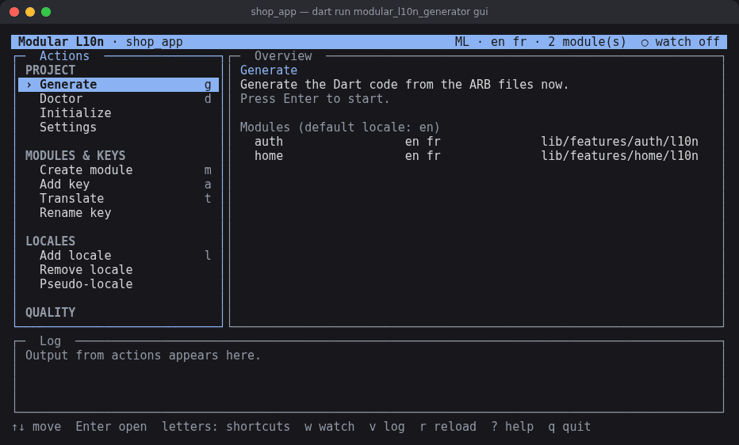

# modular_l10n_generator

Modular, type-safe Flutter localization from the command line or a terminal GUI. You keep one ARB folder per feature, and it generates one API for the whole app:

```dart
Text(ML.of(context).auth.emailLabel)
Text(ML.of(context).home.cartItems(3))   // "3 items"
```

Create modules, add keys and locales, translate, find hardcoded strings, check for mistakes, and exchange files with translators, all from a full-screen terminal app or plain commands. It works with any editor and in CI, and you only need Dart.



**📖 Documentation: [l10n.utanium.org](https://l10n.utanium.org)**

## Quick start

```sh
flutter pub add --dev modular_l10n_generator
flutter pub add intl flutter_localizations --sdk=flutter
dart run modular_l10n_generator gui
```

Pick **Initialize**, answer four questions, and you have a configured project, a first module and generated code. Then wire up `MaterialApp`:

```dart
import 'generated/modular_l10n/l10n.dart';

MaterialApp(
  localizationsDelegates: const [
    ML.delegate,
    GlobalMaterialLocalizations.delegate,
    GlobalWidgetsLocalizations.delegate,
    GlobalCupertinoLocalizations.delegate,
  ],
  supportedLocales: ML.supportedLocales,
);
```

The full walkthrough is in [Getting started](https://l10n.utanium.org/getting-started/).

To type less, activate it once and use the short name from any project:

```sh
dart pub global activate modular_l10n_generator
ml10n gui
```

## Features

- **One ARB folder per feature.** `lib/features/auth/l10n/` becomes `ML.of(context).auth`.
- **A terminal GUI** with every action, a folder browser for placing modules, a one-key-at-a-time translation screen, and watch mode. [Tour](https://l10n.utanium.org/gui/)
- **Full ICU messages**: `plural`, `select` and `selectordinal`, nested to any depth, with number and date formatting and correct CLDR ordinals.
- **Per-key fallback**: a missing translation shows the default-locale text.
- **Quality checks for CI**: missing and empty translations, ICU mistakes, unused keys, hardcoded strings, unsorted files. [CI guide](https://l10n.utanium.org/guides/ci/)
- **Translator workflow**: CSV and XLIFF 1.2 export and import, and pseudo-locales for layout testing. [Guide](https://l10n.utanium.org/guides/translators/)
- **Migration from Flutter Intl**, and it runs alongside Flutter Intl in the meantime.
- **Same output as the [VS Code extension](https://marketplace.visualstudio.com/items?itemName=UtaniumOrg.modular-flutter-l10n)**, byte for byte, from the same `pubspec.yaml` settings.

## Commands

Every GUI action is also a command. Run `dart run modular_l10n_generator help <command>` for its options, or see the [command reference](https://l10n.utanium.org/reference/commands/).

| Command | What it does |
|---|---|
| `generate` (default), `watch` | Generate the code once, or on every change |
| `gui` | Open the terminal GUI |
| `init`, `doctor` | Set up the project; check the setup |
| `create-module`, `add-key`, `rename-key` | Modules and keys |
| `add-locale`, `remove-locale`, `pseudo-locale` | Languages |
| `check`, `sort`, `unused`, `hardcoded`, `extract` | Quality |
| `export`, `import`, `migrate` | Translators and Flutter Intl |

## Configure

All settings are optional, in `pubspec.yaml`:

```yaml
modular_l10n:
  class_name: ML
  default_locale: en
  output_dir: lib/generated/modular_l10n
```

Every setting is described in [Configuration](https://l10n.utanium.org/reference/configuration/).

## More

- [Writing ARB files](https://l10n.utanium.org/guides/arb-files/): placeholders, plurals, dates, numbers
- [Android Studio and IntelliJ](https://l10n.utanium.org/guides/android-studio/): regenerate on save, extract strings from the editor
- [Migrating from Flutter Intl](https://l10n.utanium.org/guides/migrate-flutter-intl/)
- [Library API](https://l10n.utanium.org/reference/library/) for build scripts
- Runtime helpers (RTL detection, display names, plural rules): [`modular_l10n`](https://pub.dev/packages/modular_l10n)
